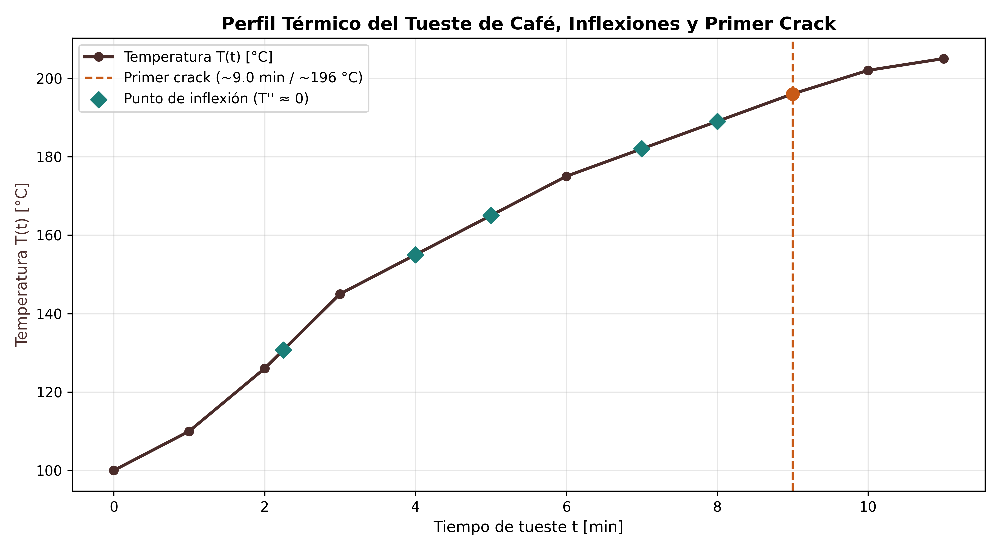
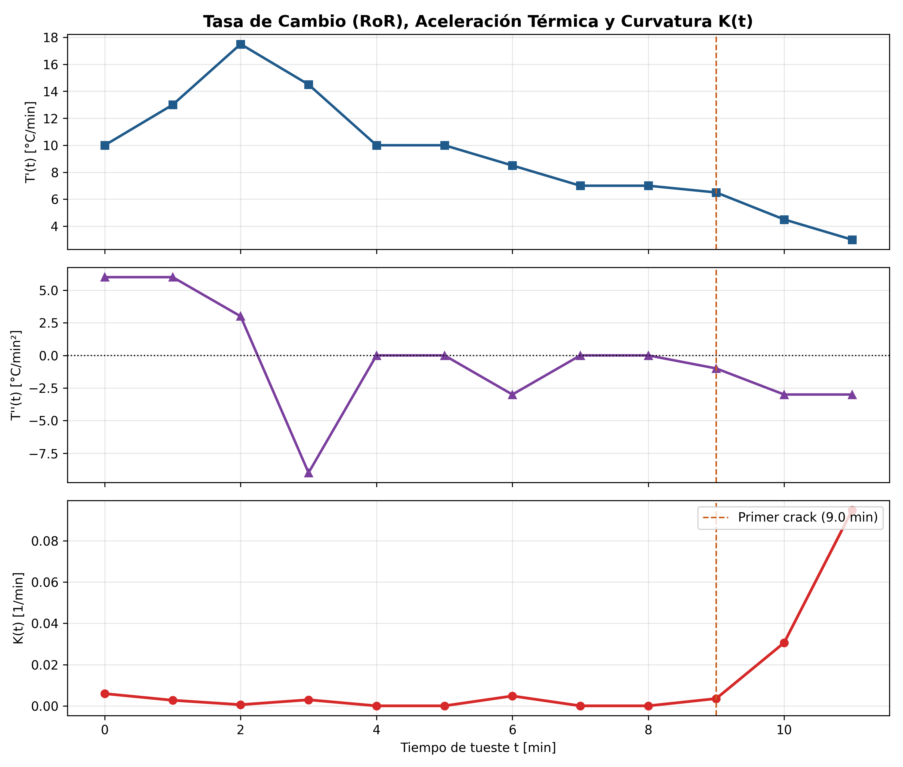
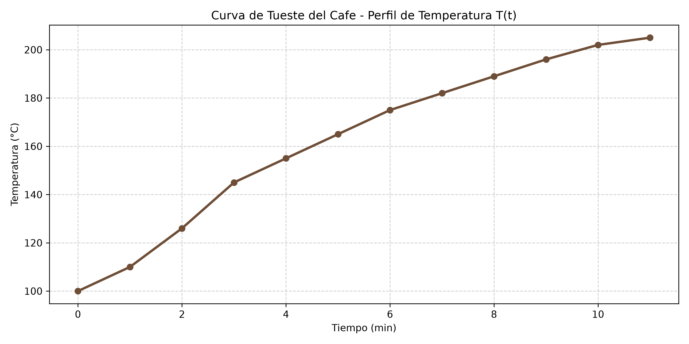

# Informe Técnico: Análisis de Curvatura Geométrica y Rate of Rise (RoR) en el Tueste del Café mediante Diferencias Finitas

## 1. Introducción y Objetivo

El proceso de tueste del grano de café involucra transferencias de calor y transformaciones fisicoquímicas complejas (secado endotérmico, reacciones de Maillard, caramelización y ruptura celular exotérmica o *Primer Crack*). El objetivo de este proyecto es aplicar **diferenciación numérica por diferencias finitas** sobre el perfil térmico del grano $T(t)$ para determinar su tasa de ascenso (*Rate of Rise*, RoR) y su curvatura geométrica $K(t)$, identificando cuantitativamente los puntos críticos y de inflexión del proceso.

---

## 2. Metodología Numérica

A partir de una serie temporal discreta con paso uniforme $\\Delta t = 1.0\\text{ min}$ desde $t_0 = 0.0\\text{ min}$ hasta $t_{11} = 11.0\\text{ min}$ ($n = 12$ registros), se aplican tres esquemas de diferenciación numérica:

1. **Primera Derivada — Rate of Rise ($T'(t) = dT/dt$ en °C/min):**

&#x20;  * **Diferencia hacia adelante (nodo inicial $i = 0$):**

&#x20;    $$T'(t_0) \\approx \\frac{T(t_1) - T(t_0)}{\\Delta t}$$

&#x20;  * **Diferencia centrada (nodos interiores $i = 1, \\dots, 10$):**

&#x20;    $$T'(t_i) \\approx \\frac{T(t_{i+1}) - T(t_{i-1})}{2\\Delta t}$$

&#x20;  * **Diferencia hacia atrás (nodo final $i = 11$):**

&#x20;    $$T'(t_{11}) \\approx \\frac{T(t_{11}) - T(t_{10})}{\\Delta t}$$

2. **Segunda Derivada — Aceleración Térmica ($T''(t) = d^2T/dt^2$ en °C/min²):**

&#x20;  * **Hacia adelante ($i = 0$):** $T''(t_0) \\approx \\frac{T(t_2) - 2T(t_1) + T(t_0)}{\\Delta t^2}$

&#x20;  * **Centrada ($i = 1, \\dots, 10$):** $T''(t_i) \\approx \\frac{T(t_{i+1}) - 2T(t_i) + T(t_{i-1})}{\\Delta t^2}$

&#x20;  * **Hacia atrás ($i = 11$):** $T''(t_{11}) \\approx \\frac{T(t_{11}) - 2T(t_{10}) + T(t_9)}{\\Delta t^2}$

3. **Curvatura Geométrica ($K(t)$):**

&#x20;  Mide la intensidad con la que la trayectoria térmica $T(t)$ cambia de dirección en cada instante:

&#x20;  $$K(t) = \\frac{|T''(t)|}{\\left(1 + [T'(t)]^2\\right)^{3/2}}$$

---

## 3. Resultados Numéricos Consolidados

| Etapa del Tueste | Tiempo $t$ (min) | Temp. $T(t)$ (°C) | Esquema Aplicado | RoR $T'(t)$ (°C/min) | Segunda Derivada $T''(t)$ (°C/min²) | Curvatura $K(t)$ |
| :--- | :---: | :---: | :---: | :---: | :---: | :---: |
| Carga del café verde | 0.0 | 100.0 | Hacia adelante | 10.00 | +6.00 | 0.00591 |
| Inicio del secado | 1.0 | 110.0 | Centrada | 13.00 | +6.00 | 0.00270 |
| Secado intermedio | 2.0 | 126.0 | Centrada | 17.50 | +3.00 | 0.00056 |
| Secado avanzado | 3.0 | 145.0 | Centrada | 14.50 | -9.00 | 0.00293 |
| Amarillamiento | 4.0 | 155.0 | Centrada | 10.00 | 0.00 | 0.00000 |
| Transición a Maillard | 5.0 | 165.0 | Centrada | 10.00 | 0.00 | 0.00000 |
| Inicio de Maillard | 6.0 | 175.0 | Centrada | 8.50 | -3.00 | 0.00349 |
| Maillard avanzado | 7.0 | 182.0 | Centrada | 7.00 | 0.00 | 0.00000 |
| Desarrollo de color | 8.0 | 189.0 | Centrada | 7.00 | 0.00 | 0.00000 |
| **Primer crack** | **9.0** | **196.0** | Centrada | **6.50** | **-1.00** | **0.00353** |
| Desarrollo del tueste | 10.0 | 202.0 | Centrada | 4.50 | -3.00 | 0.01031 |
| Descarga | 11.0 | 205.0 | Hacia atrás | 3.00 | -3.00 | 0.09487 |

---

## 4. Análisis Físico e Interpretación de las Curvas

1. **Fase Endotérmica y Máximo Impulso Térmico ($0.0\\text{ a }3.0\\text{ min}$):**

&#x20;  Durante los primeros 2 minutos el grano absorbe energía rápidamente para evaporar la humedad libre; la aceleración térmica es positiva ($T''(t) = +6.00\\text{ }^\\circ\\text{C/min}^2$) y el *Rate of Rise* alcanza su pico máximo en $t = 2.0\\text{ min}$ con **$17.50\\text{ }^\\circ\\text{C/min}$**.

2. **Punto de Inflexión en el Secado Avanzado ($t = 3.0\\text{ min}$):**

&#x20;  En $t = 3.0\\text{ min}$ ($145\\text{ }^\\circ\\text{C}$), la segunda derivada cambia abruptamente de $+3.00$ a $-9.00\\text{ }^\\circ\\text{C/min}^2$, marcando el punto de inflexión principal donde finaliza la aceleración inicial del calentamiento y comienza la desaceleración controlada del RoR hacia la etapa de amarillamiento.

3. **Estabilidad en Reacciones de Maillard ($4.0\\text{ a }8.0\\text{ min}$):**

&#x20;  Entre los minutos 4 y 5 ($155\\text{–}165\\text{ }^\\circ\\text{C}$) y entre los minutos 7 y 8 ($182\\text{–}189\\text{ }^\\circ\\text{C}$), la pendiente de calentamiento es constante ($T''(t) = 0$), por lo que la curvatura geométrica $K(t)$ se anula ($0.00000$). Esta linealidad controlada evita el arrebatamiento externo del grano y favorece el desarrollo uniforme de precursores aromáticos.

4. **Primer Crack y Fase de Desarrollo ($9.0\\text{ a }11.0\\text{ min}$):**

&#x20;  Al alcanzar los $196\\text{ }^\\circ\\text{C}$ en $t = 9.0\\text{ min}$ ocurre el **Primer Crack** (reacción exotérmica de fractura de la pared celular por presión interna de vapor y $\\text{CO}_2$). A partir de este punto, el RoR desciende progresivamente de $6.50$ a $3.00\\text{ }^\\circ\\text{C/min}$ en la descarga ($205\\text{ }^\\circ\\text{C}$), incrementando la curvatura geométrica $K(t)$ conforme la curva térmica tiende a estabilizarse horizontalmente.

---

## 5. Conclusiones

* La aplicación de **diferencias finitas** con paso uniforme $\\Delta t = 1.0\\text{ min}$ permite cuantificar de forma directa la velocidad de calentamiento ($RoR$) y detectar las transiciones térmicas críticas del tueste sin requerir una expresión analítica cerrada de la temperatura.

* La curvatura geométrica $K(t)$ resulta altamente sensible a los cambios de concavidad en el inicio del secado y en la etapa final de desarrollo/descarga, complementando el monitoreo tradicional basado únicamente en la temperatura absoluta del grano.

---

## 6. Gráficas de Resultados

### Perfil Térmico y Puntos de Inflexión

### Derivadas (RoR, Segunda Derivada) y Curvatura Geométrica $K(t)$

### Curva Base de Temperatura T(t)

