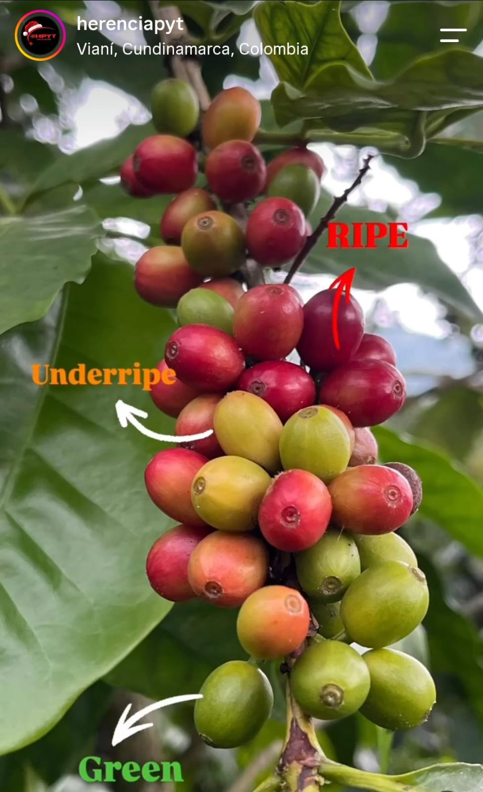
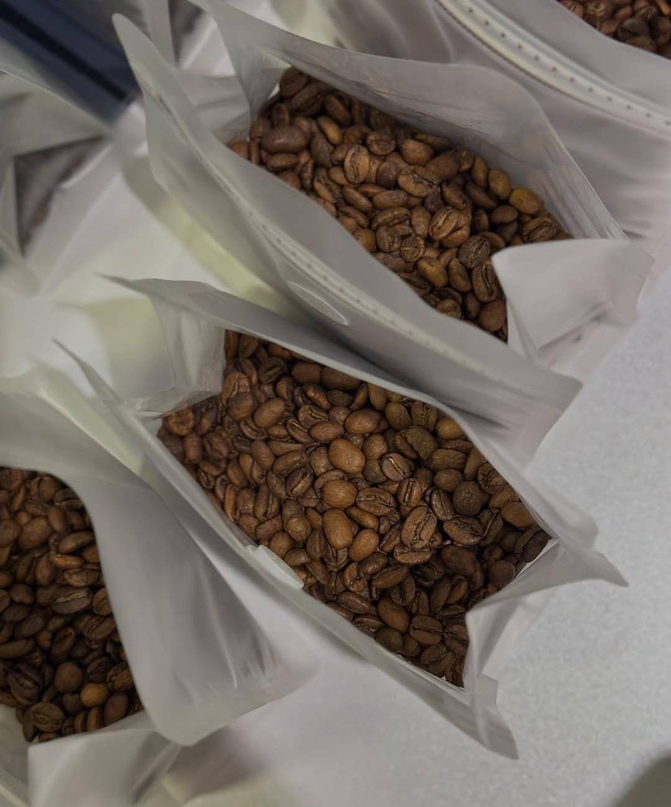
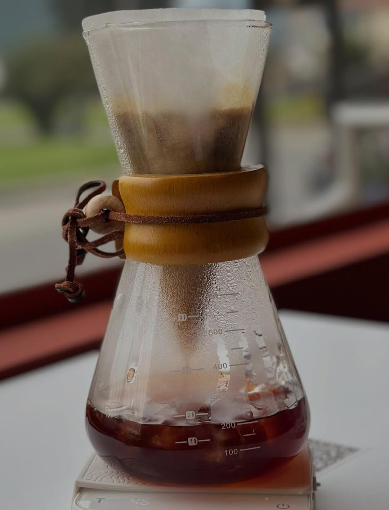
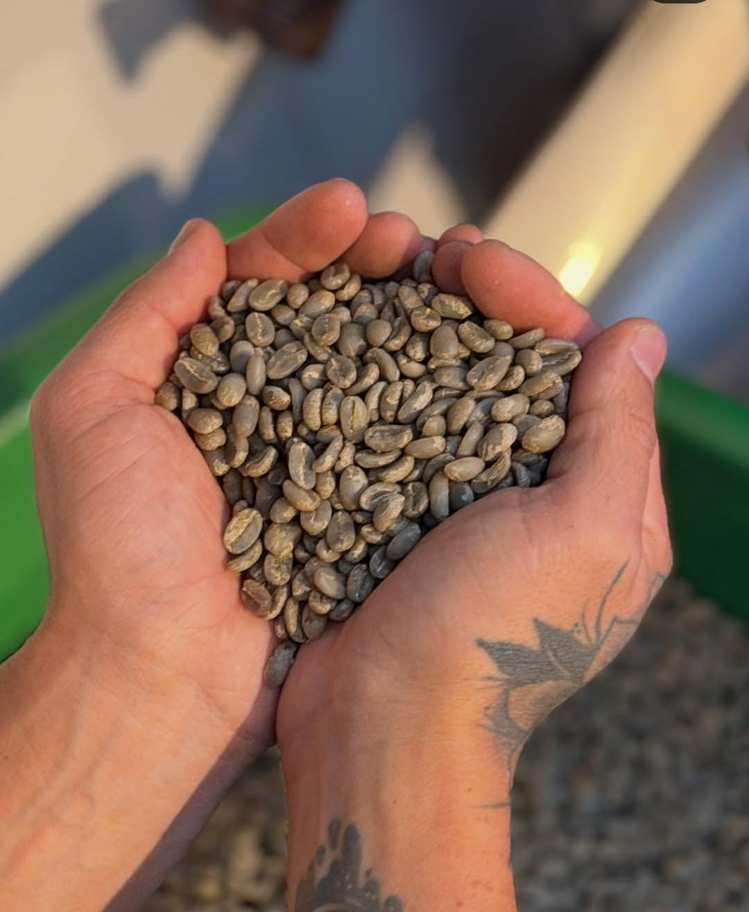

# Extraccion_cafe
# Proceso de Extracción de Café - Café HERENCIA

## Contexto y Ubicación
- **Lugar:** Café HERENCIA
- **Ubicación:** Frente a la sede principal de la Universidad de Cundinamarca (Facatativá, Cundinamarca).
- **Origen del Café:** Grano especial cosechado y producido directamente en finca familiar cafetera.

##  Misión y Visión
- **Misión:** Ofrecer a la comunidad universitaria una experiencia sensorial de café de especialidad de origen, destacando el proceso artesanal y el cuidado del grano desde la finca.
- **Visión:** Posicionarse como el espacio de encuentro de referencia en Facatativá para el consumo, aprendizaje y cultura del café artesanal.

##  Variedades y Perfil Sensorial (Notas de Cata)
En Café HERENCIA se utilizan variedades seleccionadas de proceso artesanal para la preparación de espresso:
- **Variedades utilizadas para Espresso:** Castillo Lavado, Caturra Chiroso y Borbón Rojo.
- **Notas de Cata / Perfil Sensorial:** Chocolate, panela, notas avinadas y frutales.

##  Proceso de Extracción y Variables Clave
Modelamos y analizamos las variables físicas en la máquina de espresso para obtener una taza equilibrada:
- **Dosis de café (Masa molida):** 18.0 gramos
- **Temperatura del agua:** 96 °C
- **Presión de extracción:** 19 a 20 bares
- **Tiempo óptimo de flujo:** 28 segundos
- **Rendimiento en taza (Masa líquida):** 45 gramos (Ratio 2.5)

##  Comportamiento Físico del Café en la Mañana
Durante las primeras horas del día se observan variaciones en el flujo de la extracción debido a factores ambientales y térmicos:

1. **Humedad Ambiental e Higroscopía:**
   Por las mañanas, la alta humedad relativa de Facatativá hace que las partículas de café molido absorban agua del ambiente. Esto provoca que el café se expanda y se compacte más en el portafiltro, generando mayor resistencia y reduciendo los gramos de bebida en taza (flujo lento / tendencia a subextracción).

2. **Temperatura del Molino y la Máquina:**
   Al arrancar la jornada, las muelas del molino y el grupo de extracción están fríos. A medida que avanza el día, la fricción y el uso continuo elevan la temperatura del equipo, acelerando el flujo de extracción.

<<<<<<< HEAD
  ## Variables de extracción de café

En este apartado se encuentran las variables utilizadas
para analizar el proceso de extracción de café.


```python
temperatura = 90
tiempo_extraccion = 4
cantidad_cafe = 20
volumen_agua = 300
```


# Variables utilizadas en el proyecto

Para desarrollar el análisis se identificaron cuatro variables independientes y una variable dependiente.
# Temperatura del agua

La temperatura es una variable importante porque influye en la velocidad a la que los compuestos solubles del café pasan al agua.

El análisis de esta variable permite estudiar cómo cambian los resultados de extracción cuando se utilizan diferentes temperaturas.

En Python se identifica como temperatura_C.

# Cantidad de café

Esta variable representa la cantidad de café utilizada por cada 100 mL de agua.

Su importancia consiste en que la proporción entre café y agua influye en la concentración final de la bebida.

En Python se identifica como cafe_g_por_100mL_agua.

# Tamaño de partícula

El tamaño de partícula se relaciona con el grado de molienda del café.

Las partículas más pequeñas presentan una mayor superficie de contacto por unidad de masa, lo que puede favorecer la transferencia de compuestos solubles al agua.

En Python se identifica como tamano_particula_mm.

# Tiempo de extracción

El tiempo de extracción representa el periodo durante el cual el agua permanece en contacto con el café.

Esta variable permite estudiar cómo cambia la concentración de sólidos disueltos según la duración del proceso.

En Python se identifica como tiempo_extraccion_h.

# Sólidos disueltos totales (TDS)

Los sólidos disueltos totales representan la concentración de sustancias solubles extraídas del café y presentes en la bebida.

Esta es la variable dependiente del proyecto, ya que se estudia su comportamiento frente a las diferentes condiciones experimentales.

En Python se identifica como TDS_porcentaje.

Es importante aclarar que el porcentaje de TDS y el rendimiento de extracción son indicadores diferentes.

# Herramientas utilizadas

Para desarrollar el proyecto se utilizaron las siguientes herramientas:

Python: lenguaje de programación empleado para procesar y analizar los datos.

Jupyter Notebook: entorno de trabajo donde se desarrollaron y organizaron los códigos.

Pandas: biblioteca utilizada para importar y organizar los datos experimentales.

Matplotlib: biblioteca utilizada para elaborar gráficos.

NumPy: biblioteca de apoyo para operaciones numéricas.

Scikit-learn: biblioteca utilizada para construir y evaluar un modelo predictivo.

GitHub: plataforma utilizada para almacenar y compartir el proyecto.

# Importancia de Python en el proyecto

El uso de Python permite comprender cómo la programación puede apoyar el análisis de procesos experimentales.

Mediante este proyecto se desarrollan habilidades relacionadas con la creación de variables, importación de datos, uso de bibliotecas, operaciones estadísticas y elaboración de gráficos.

También se aprende a interpretar información científica y a utilizar modelos matemáticos para estudiar procesos físicos y químicos.

# Relación con la Ingeniería Ambiental

Este proyecto permite aplicar herramientas computacionales al estudio de un proceso de transferencia de materia.

Desde la Ingeniería Ambiental, el análisis de variables experimentales es importante porque se utiliza en diferentes áreas, como el tratamiento de agua, la evaluación de contaminantes, los procesos de separación y la optimización de operaciones.

El trabajo con datos también fortalece la capacidad de interpretar resultados y tomar decisiones fundamentadas en información cuantitativa.

# Conclusiones

La extracción de café es un proceso que depende de diferentes variables físicas y operativas, como la temperatura, el tiempo, la cantidad de café y el tamaño de partícula.

Python permite organizar y analizar conjuntos de datos experimentales de manera estructurada, facilitando la interpretación de los resultados.

Las representaciones gráficas ayudan a identificar posibles relaciones entre las condiciones de extracción y la concentración de sólidos disueltos totales.

Los modelos predictivos permiten realizar estimaciones bajo determinadas condiciones, aunque su confiabilidad depende de la cantidad y calidad de los datos utilizados.

El desarrollo del proyecto contribuye al aprendizaje de los fundamentos de programación y demuestra la utilidad de las herramientas computacionales en el análisis de procesos relacionados con la Ingeniería Ambiental.

### TABLA 1: VARIACION DE DOSIS

| Fila | Dosis (g) | Rendimiento (g) | Ratio (g/g) | Tiempo est. (s) | Caudal (g/s) | EY sim (%) | Diagnostico |
| :--- | :---: | :---: | :---: | :---: | :---: | :---: | :--- |
| 0 | 15.0 | 45.0 | 3.00 | 25.8 | 1.74 | 18.80 | Zona equilibrada |
| 1 | 16.5 | 45.0 | 2.73 | 26.9 | 1.67 | 18.37 | Zona equilibrada |
| 2 | 18.0 | 45.0 | 2.50 | 28.0 | 1.61 | 18.00 | Zona equilibrada |
| 3 | 19.5 | 45.0 | 2.31 | 29.0 | 1.55 | 17.66 | Zona equilibrada |
| 4 | 21.0 | 45.0 | 2.14 | 30.0 | 1.50 | 17.35 | Zona equilibrada |

### TABLA 2: VARIACION DE RENDIMIENTO / RATIO

| Fila | Dosis (g) | Rendimiento (g) | Ratio (g/g) | Tiempo est. (s) | Caudal (g/s) | EY sim (%) | Diagnostico |
| :--- | :---: | :---: | :---: | :---: | :---: | :---: | :--- |
| 0 | 18.0 | 30.0 | 1.67 | 18.7 | 1.60 | 14.12 | Subextraccion / flujo rapido |
| 1 | 18.0 | 36.0 | 2.00 | 22.4 | 1.61 | 15.74 | Subextraccion / flujo rapido |
| 2 | 18.0 | 45.0 | 2.50 | 28.0 | 1.61 | 18.00 | Zona equilibrada |
| 3 | 18.0 | 54.0 | 3.00 | 33.6 | 1.61 | 20.08 | Zona equilibrada |
| 4 | 18.0 | 63.0 | 3.50 | 39.2 | 1.61 | 22.03 | Sobreextraccion / flujo lento |

### TABLA 3: VARIACION DE TEMPERATURA

| Fila | Temp. agua (C) | Tiempo est. (s) | Caudal (g/s) | EY sim (%) | Diagnostico |
| :--- | :---: | :---: | :---: | :---: | :--- |
| 0 | 90.0 | 28.5 | 1.58 | 17.39 | Zona equilibrada |
| 1 | 93.0 | 28.3 | 1.59 | 17.71 | Zona equilibrada |
| 2 | 96.0 | 28.0 | 1.61 | 18.00 | Zona equilibrada |
| 3 | 98.0 | 27.8 | 1.62 | 18.19 | Zona equilibrada |
| 4 | 99.0 | 27.7 | 1.62 | 18.29 | Zona equilibrada |

### TABLA 4: VARIACION DE PRESION

| Fila | Presion (bar) | Rango ref. (19-20) | Tiempo est. (s) | Caudal (g/s) | EY sim (%) | Diagnostico |
| :--- | :---: | :---: | :---: | :---: | :---: | :--- |
| 0 | 16.0 | Fuera | 26.5 | 1.70 | 17.75 | Zona equilibrada |
| 1 | 18.0 | Fuera | 27.4 | 1.64 | 17.90 | Zona equilibrada |
| 2 | 19.5 | Dentro | 28.0 | 1.61 | 18.00 | Zona equilibrada |
| 3 | 20.0 | Dentro | 28.2 | 1.60 | 18.05 | Zona equilibrada |

### Imágenes del proyecto






